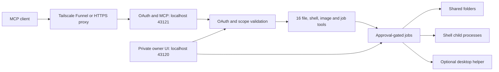

# Architecture

Node 22+ serves a dependency-free MCP backend and a static HTML/CSS/JavaScript owner UI. Electron optionally wraps the same server and provides an authenticated native folder-picker callback.

`server.mjs` composes config, OAuth, workspaces, jobs, computer and Tailscale services. Public routes never expose owner APIs. The owner UI only manages connection settings, grants and approvals; incoming MCP clients initiate work.

OAuth uses a locally minted one-use browser verification ticket, an owner cookie, DCR, PKCE S256, exact redirect allowlists, resource/issuer binding, opaque token hashes and rotating refresh tokens. File, shell and computer capabilities require their respective scopes. There are no local-engine scopes.

The job registry binds retries to a client and the full request payload. File/shell mutations wait for owner approval by default. Progress and results are bounded, persistent events. Restarted requests become interrupted; they are not replayed. Process cancellation uses process groups on Unix and taskkill on Windows.

The desktop renderer has no Node integration or preload. Its folder button calls the private owner API, which invokes Electron's native directory dialog. Without that callback, the browser UI uses a path field. Local API calls require the per-run admin credential plus Host/Origin checks.

Configuration and logs are stored privately outside shared folders. See [SETUP.md](SETUP.md) and [SECURITY.md](../SECURITY.md).
