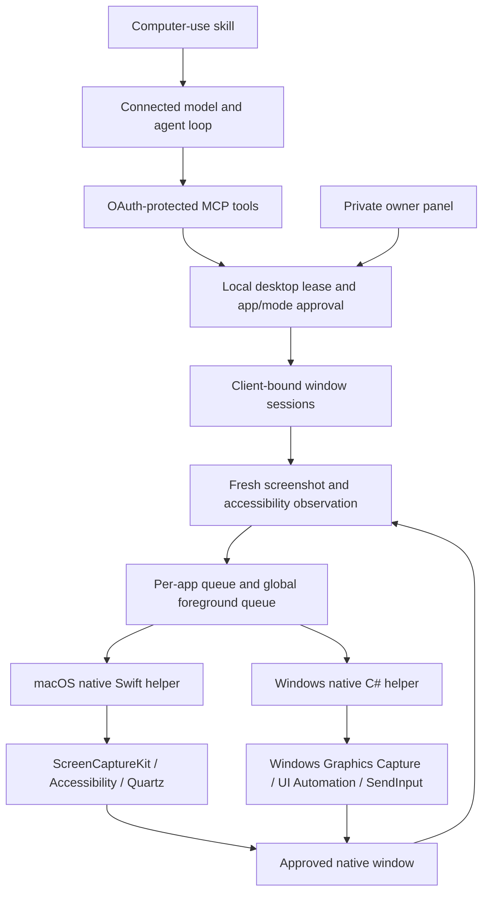

# Native computer use

Codex Link has separate native desktop backends for macOS and Windows. This is an independent implementation of a documented computer-use workflow, not a copy of OpenAI's proprietary runtime and not a claim of 1:1 capability, safety, latency or task-success parity. The connected MCP client supplies the model and agent loop. No local model, cloud relay replacement or browser/CDP engine is installed by this feature.

The original agent-facing instructions live in [`computer/SKILL.md`](../computer/SKILL.md), also exposed as the MCP resource `codex-link://computer-guide`. The complete tool descriptors are in [`mcp-tools.json`](mcp-tools.json).

## Architecture



The helpers accept one bounded JSON request on stdin and return one JSON response on stdout, then exit. They do not listen on a network port, run arbitrary supplied scripts, change app permissions or elevate themselves. The separate macOS `request_permissions` operation only shows standard OS consent prompts and is reachable from the private owner UI, not the MCP tool set. The owner still makes each OS decision.

## Platform implementations

| Area | macOS | Windows |
|---|---|---|
| Native language | Swift | C# / .NET 10 |
| Target baseline | macOS 14 or later | Windows 10 build 19041 or later on a .NET-supported OS; Windows 11 recommended for acceptance testing |
| Architectures | arm64 and x64 | arm64 and x64 |
| Window identity | CGWindowID, PID, launch date, bundle ID and executable | HWND, PID, process start time, AUMID when available and executable |
| Screenshot | ScreenCaptureKit desktop-independent window capture | Windows Graphics Capture; PrintWindow only when WGC is unsupported |
| Semantic context | Accessibility window tree | UI Automation ControlView tree |
| Semantic actions | AXPress, writable values, selection, expanded state | Invoke, Value, SelectionItem, Toggle and ExpandCollapse patterns |
| Default input mode | Background, with app-dependent support | Foreground real desktop input |
| Background input | Accessibility actions and process-targeted Quartz events; no guaranteed private cursor | UI Automation semantic actions only; no background pixel/keyboard fallback |
| Foreground input | Explicitly approved Quartz HID events | Explicitly approved SendInput events |
| Unicode | Unicode keyboard events; no clipboard replacement | UTF-16 Unicode SendInput; no clipboard replacement |
| Display handling | Window geometry, Retina scaling, negative monitor origins | PerMonitorV2 DPI awareness, virtual desktop coordinates, negative monitor origins |
| Emergency input checks | Pointer corners; held human modifiers/buttons for keyboard/pixel input | Pointer corners, held Escape, held human modifiers/buttons |
| Locked use | Not implemented; session checks refuse unavailable/locked desktop | Not implemented; secure or unavailable input desktops are refused |

Neither helper bypasses secure keyboard entry, protected fields, denied screen capture, elevated targets or OS permission refusals. The Windows executable requests `asInvoker` and `uiAccess=false`. A capture permission failure never triggers an alternate screenshot method intended to evade that denial. The Windows capture indicator is not disabled.

## Build and launch

From the source repository, with Node 22 or newer:

```sh
npm ci
npm run check
npm test
npm run computer:build
npm run computer:doctor
```

On macOS, building requires Xcode Command Line Tools. The build command uses Swift, system frameworks and ad-hoc development signing. On Windows, building requires the .NET 10 SDK. Windows publishes a self-contained executable; a packaged end-user installation does not require a separate .NET runtime. The native paths do not require Python.

Build another supported target explicitly:

```sh
node scripts/build-computer.mjs --platform=darwin --arch=arm64
node scripts/build-computer.mjs --platform=darwin --arch=x64
node scripts/build-computer.mjs --platform=win32 --arch=x64
node scripts/build-computer.mjs --platform=win32 --arch=arm64
```

macOS helpers must be compiled on a Mac. Windows binaries can be cross-published with the .NET SDK, but cross-compilation is not Windows runtime validation. The script runs `--self-test` only when the binary matches the host platform and architecture.

Each target is written to `computer/bin/<platform>-<arch>/`, with a source-hash build manifest. The build script never enables a desktop lease or grants OS permissions. Standalone `computer:doctor` does not open or modify the running bridge's private configuration.

To run the updated Electron source, quit the previous Codex Link instance locally, then run:

```sh
npm ci --prefix desktop
npm run desktop
```

An already installed DMG/EXE is not updated by editing the source directory. Launch from source or build/install a new package. The existing instance is deliberately not restarted by the implementation scripts. Refresh the connected client's MCP tool discovery after switching to the new build; this source advertises 24 tools.

### Packaging

`desktop/native-before-pack.cjs` refuses to package a missing or stale helper. `desktop/native-after-pack.cjs` copies only the helper directory matching that Electron platform/architecture. Intermediate Windows `bin`/`obj` output and binaries for other platforms are excluded from generic resources.

Build every helper target requested by an Electron packaging command beforehand. For example, a combined arm64/x64 Mac and Windows build requires all four corresponding native outputs. `npm --prefix desktop run dist` retains the repository's ordinary packaging configuration. Use a separate `--config.directories.output` path for preview packages to avoid replacing existing release artifacts.

Development ad-hoc signing is not Developer ID signing, notarization, Authenticode signing or an audited updater. Production distribution needs those separate release controls. A changed Mac helper signature/path may require the owner to reapprove OS permissions.

## Owner permissions

The existing local computer lease remains off by default. The owner can allow 15 minutes or explicitly enable persistent access. Temporary permission is reset on restart; persistent permission is not. Native app sessions are always temporary and memory-only, even when the global lease is persistent.

In **Settings → Native application access**, the owner can inspect capabilities, list open application identities, save an exact allow/block rule and input mode, remove rules, or end a session. On macOS, the diagnostics section includes a separate button to request standard Screen Recording and Accessibility prompts. Requests do not grant themselves permission and are never initiated by a remote tool.

Without a saved allow rule, `computer_session_start` enters the existing local Activity approval flow. The inspector displays the actual executable and requested mode. Foreground access is a separate approval from background access. A block rule wins over any allow rule for that app. Rules match an application identity and executable path, not just a friendly name. They are not publisher-signature attestation and do not defend against an attacker already running as the owner.

Dangerous mode may enable the global desktop lease but does not bypass native app approvals, protected-target checks or the separate legacy opt-in. OAuth `computer:use` is required in all modes. Saved allow rules apply to authorized computer-use clients while the lease is enabled; they do not authorize unrelated consequential actions.

## Tool workflow

| Tool | Result |
|---|---|
| `computer_capabilities` | Backend, build status, OS readiness and explicit limitations; no screenshot or prompt |
| `computer_windows` | Real window/app identities; window titles withheld until an approved session |
| `computer_session_start` | Local approval-gated job; completed result contains `sessionId` |
| `computer_observe` | Window JPEG as MCP image content plus accessibility elements and `observationId` |
| `computer_interact` | One validated action job; poll to completion and observe again |
| `computer_session_end` | Closes this connection's session and aborts its tracked helper |

Sessions bind to both OAuth client ID and grant ID. They also bind to window ID, PID, process start identity, executable and app identifier. A window/process change while approval is pending rejects the request. The model cannot redirect an existing approved session to another window by supplying a new ID.

Each observation is valid for 30 seconds and only one attempted input. Requests use pixels in the returned image, not raw Retina pixels or global desktop coordinates. The Node layer maps image pixels to the current native window geometry. Accessibility bounds are tagged with their coordinate space; tree-only observations cannot authorize pixel actions.

Element paths and fingerprints are held by the bridge and revalidated by the helper. The model sees temporary element IDs. Semantic actions fail rather than silently switching to pixel input. Actions invalidate other observations for the same app process, including on uncertain errors. Use the same idempotency key to retry exactly the same network request, not a new key to replay an uncertain click.

An input result is not evidence of application success. The skill requires a subsequent observation and verification of the intended outcome. `set_value` replaces a writable field value; `type` inserts into verified current focus. Key chords accept distinct modifiers and one non-modifier key. Dragging requires a foreground session and explicit start/destination coordinates.

## Bounds and cancellation

Sessions are capped at eight and at 15 minutes each, additionally bounded by the current owner lease. Accessibility traversal defaults to 250 elements/depth 8, with maxima of 500/depth 12 and a best-effort traversal deadline. Screenshots default to maximum side 1800 pixels, configurable from 320 to 2560.

Each helper has a 128 KiB request bound, 8 MiB combined process output bound and 20-second maximum execution deadline. A shorter session/permission expiry aborts the helper sooner. Native provider calls can block; the process deadline is the outer bound, not a claim every Accessibility/UI Automation call returns promptly.

Foreground operations share one queue with legacy input. Background operations serialize per application process; separate applications can run concurrently. This permits concurrency where the OS/app supports it but is not equivalent to isolated virtual desktops or independent hardware cursors.

Stop, revoke, policy changes and session closure invalidate tracked work. Cancellation is best-effort. It cannot undo a sent message, delivered click or completed app action, and a force-killed process may not run every cleanup handler. After interruption, inspect the application before retrying. Observations and sessions are not replayed after restart.

## Migration from PyAutoGUI

The old `computer_screenshot` and `computer_action` tools remain for compatibility, but require a new explicit local **Allow unscoped legacy desktop tools** toggle in addition to the desktop lease. They are disabled by default. The legacy Python environment/setup command remains available for users who deliberately opt in.

Legacy operations can capture or operate the entire primary desktop and do not enforce native app rules. Do not enable legacy compatibility merely to bypass a native refusal. Direct file/shell tools retain their own authorization behavior; desktop policy is not an OS sandbox around arbitrary shell commands.

## Known limits and acceptance testing

This implementation does not reproduce Codex's private cursor environment, privileged macOS locked-use authorization plugin, internal model/harness, task-success rate, browser-specific engine, remote account relay or enterprise management plane. It does not claim those features are impossible; they are outside the implementation verified here.

Background Quartz delivery depends on the application. An app may activate itself; immediate observed foreground changes close the session, but delayed activation or other human/app races cannot be universally prevented. Public macOS AX windows are matched by unique bounds; ambiguous matches are rejected. Windows UI Automation depends on provider support. Window capture can fail for protected, blank, minimized or unusual graphics surfaces. The conservative blank-capture check can reject a legitimately all-black window.

App rules and known-terminal/security-app exclusions are not a security sandbox. An allowed app can invoke other apps or expose embedded command surfaces. Focus/hit testing reduces accidental misdelivery but cannot make arbitrary desktop input transactional. Protected accessibility values are redacted; screenshot pixels can still contain sensitive visible data. Typed native tool payloads are redacted before job persistence; other tools and app output are not a general secret-redaction system.

Automated tests cover policies, client/grant isolation, session expiry, stop/cancellation, idempotency, stale observations, typed-text redaction, coordinate transforms, tool registration and owner API boundaries. Native self-tests cover pure geometry/key/ABI logic. Builds and mocked tests do not establish real-app compatibility.

Before release, test on real Windows x64/arm64 and macOS Intel/Apple Silicon systems: a simple editable app, browser/native UI, mixed-DPI monitors including negative origins, moved/resized windows, protected fields, blocked/elevated apps, minimized/occluded windows, held modifiers, pointer-corner/Escape stop, expired sessions, revocation, process replacement, cancellation mid-input, clipboard format preservation, screenshot indicators and restart recovery. Verify screenshots and app outcomes manually. Do not automate privileged/security prompts during acceptance tests.

## Primary design references

Public behavior and API references checked during implementation on September 10, 2026:

- [OpenAI Computer Use documentation](https://developers.openai.com/codex/app/computer-use): MCP-plus-skill structure, platform-specific foreground/background behavior, app approvals and locked-use constraints. This does not disclose the proprietary native implementation.
- [Apple ScreenCaptureKit screenshot manager](https://developer.apple.com/documentation/screencapturekit/scscreenshotmanager).
- [Microsoft UI Automation control patterns](https://learn.microsoft.com/en-us/dotnet/framework/ui-automation/ui-automation-control-patterns-overview).
- [Microsoft GraphicsCaptureItem interop](https://learn.microsoft.com/en-us/windows/win32/api/windows.graphics.capture.interop/nn-windows-graphics-capture-interop-igraphicscaptureiteminterop).
- [Microsoft SoftwareBitmap GPU surface copy](https://learn.microsoft.com/en-us/uwp/api/windows.graphics.imaging.softwarebitmap.createcopyfromsurfaceasync).
- [Microsoft SendInput](https://learn.microsoft.com/en-us/windows/win32/api/winuser/nf-winuser-sendinput).
- [Microsoft per-monitor DPI awareness](https://learn.microsoft.com/en-us/windows/win32/api/winuser/nf-winuser-setprocessdpiawarenesscontext).
- [Microsoft .NET support policy](https://dotnet.microsoft.com/en-us/platform/support/policy/dotnet-core).
