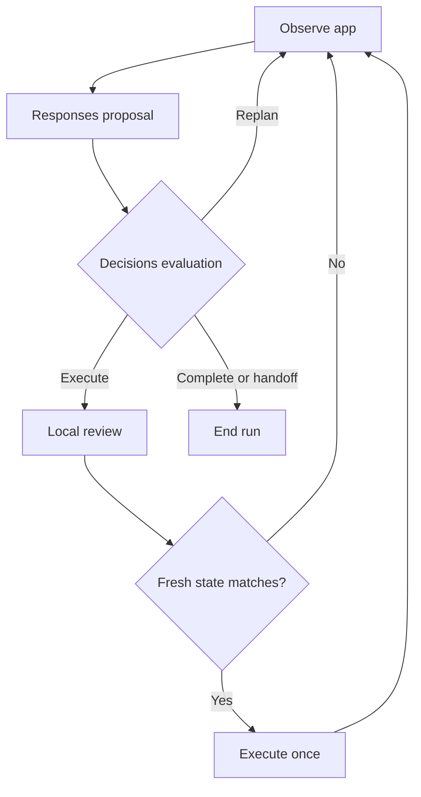

# OpenAI computer-use mode

Codex Link can run an optional paid API loop inside an approved app session. The Responses API proposes one structured action; the Decisions API evaluates the proposed action against the task and current screenshot. Decisions returns classification/choice scores, not generated actions, so both APIs are required. The existing connected-client computer tools remain available.

## Set up and run

1. Open Settings → OpenAI computer use. Enter your OpenAI API key, enable the mode and save. Leave the key field blank on later saves to keep the existing key; Remove saved key deletes it.
2. Set a Responses model supporting images and structured outputs (default `gpt-6.1-sol`). The Decisions default is `gpt-6-luna`, the model currently documented as supported. Both names are editable for future API changes. Your API project must have access and billing enabled; a ChatGPT subscription is not used for these requests.
3. Enable Desktop control. Use Find apps and Start app session, then approve the session in Activity. macOS uses the installed Codex Computer Use app-server relay; Windows uses the existing native backend. This mode does not install another desktop driver.
4. Enter a task for that app and start a run. In Activity, approve sending the task, app text and screenshots to OpenAI. Review each proposed action before allowing it. These reviews remain required even in dangerous mode.
5. Inspect the resulting app state. Cancel the job, pause access, disable desktop control or end the session to stop further input. Actions already performed are kept.

Connected MCP clients can instead call `computer_api_status` and `computer_api_run` with an existing session from `computer_session_start`, the task and a unique `idempotencyKey`. Poll `job_get` and use `job_cancel` to stop. Reusing the same key retrieves the same job; changed arguments with that key are rejected. The session and result remain bound to the connection and grant. Local UI sessions and remote sessions cannot be used interchangeably.

## Bounds and outcomes

Each iteration observes, proposes, evaluates, requests review, reobserves and dispatches at most one action. If the screenshot/accessibility state changes during review, the proposal is discarded and replanned. Fresh observation IDs are checked by the desktop backend. Refusals, malformed output, confidence below 0.8 and manual-input situations stop without input. Network and uncertain input failures are never automatically retried. No generated JavaScript or shell code is executed by this mode.

The default limit is 20 iterations, configurable from 1 to 50. A caller can lower the configured limit. Every run has a five-minute wall-time limit including local review and a 25-second timeout per API request. Each iteration normally makes one Responses and one Decisions request; review-induced replanning also consumes iterations and API credits. This bounds requests, not a dollar amount. Screenshots remain in memory and are not stored in job history. Responses uses `store: false`; OpenAI's applicable retention policies still apply.

`completed` means the planner and evaluator agree that the observed task is complete; it is not an independent success guarantee. `handoff`, `denied` and `step_limit` are normal loop outcomes and may be returned by a completed job. API/helper failures make the job fail. Always inspect both the job status and its result outcome.

Passwords, authentication, payments, tasks outside the app and shell/code execution are handed back to the user. Model evaluation is advisory: existing app/session restrictions, native target checks and local reviews enforce control. Treat all screen content as untrusted.

## Key storage and privacy

The API key is write-only in the authenticated local settings API and is sent only in the Authorization header to the fixed `https://api.openai.com/v1/responses` and `/decisions` endpoints. Redirects are rejected. The UI and MCP status expose only whether a key exists. Keys and raw upstream errors are excluded from activity and API responses.

The key is stored separately from config in `openai-key.json` in Codex Link's private application data directory. It is plaintext at rest, with mode 0600 on Unix; Windows uses the user's application-data directory permissions. This is not OS keychain encryption. Do not share the app data directory. Task text and locally reviewed action details can be retained in local job history, so enter credentials directly in the app during a handoff.

## Validation

Mocked HTTP and desktop tests cover the API payload schemas, inline image transport, key privacy and removal, action review, fresh-state checks, refusals, confidence gates, step bounds, cancellation, failure non-replay, grant isolation and retry keys. They do not establish live model quality or platform access. A live end-to-end run requires your API key and a macOS/Windows desktop.

Official references:

- [Decisions guide](https://developers.openai.com/api/docs/guides/decisions)
- [Decisions request and response schema](https://developers.openai.com/api/reference/resources/decisions/methods/create)
- [Structured outputs](https://developers.openai.com/api/docs/guides/structured-outputs)
- [Computer use](https://developers.openai.com/api/docs/guides/tools-computer-use)
